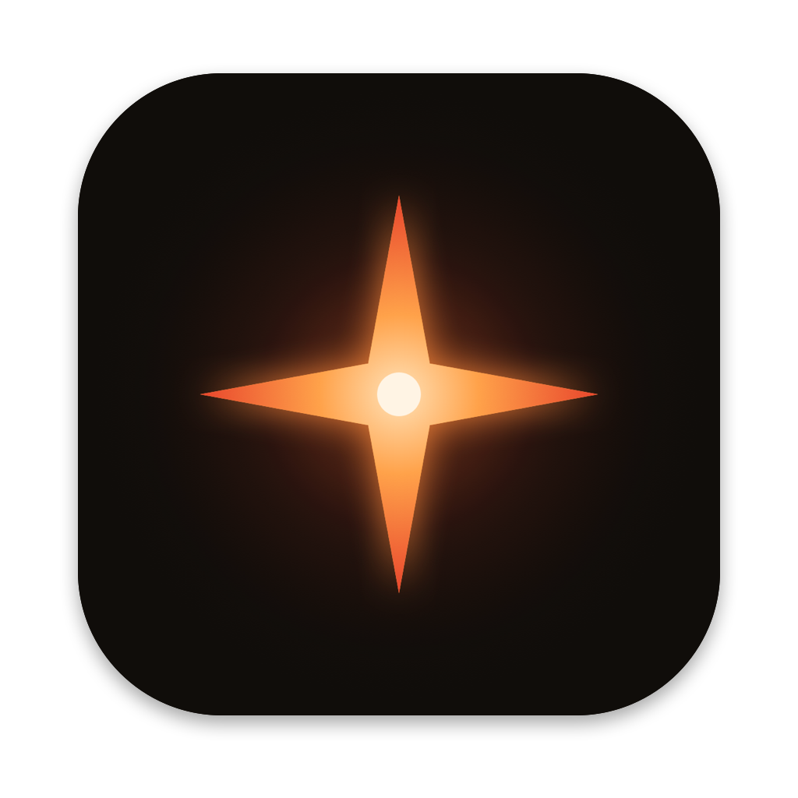
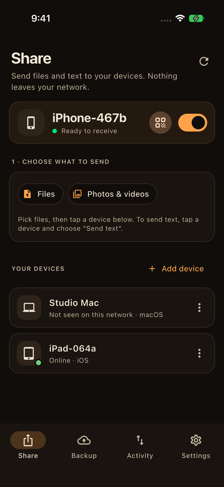
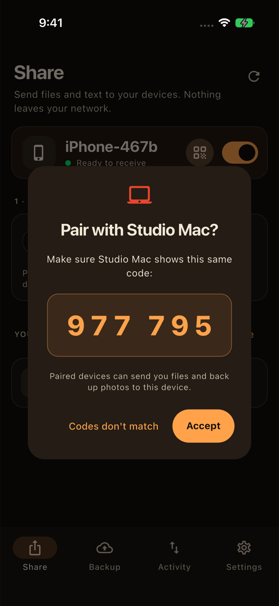
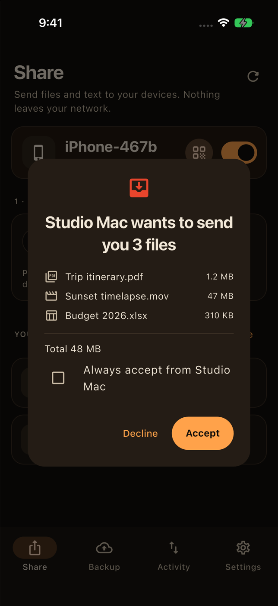
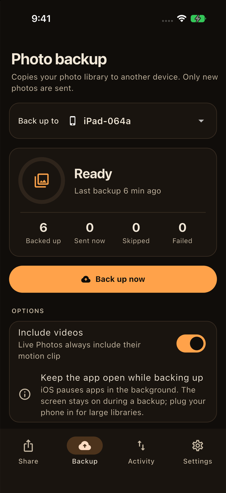

<div align="center">



# Lucero Sync

**Share files and back up photos between your own devices, directly over Wi-Fi. No cloud, no account.**

[](https://github.com/lucerowb/lucero-sync/actions/workflows/ci.yml)
[](LICENSE)


[Website](https://lucerosync.lucerowb.com/) · [User guide](https://lucerosync.lucerowb.com/guide.html) · [Download](https://github.com/lucerowb/lucero-sync/releases/latest) · [Architecture & security](ARCHITECTURE.md)

<p>
  
  
  
  
</p>

</div>

---

Lucero Sync moves files between your phones and computers on the same Wi-Fi. Devices talk to each other directly, over an encrypted connection pinned to each device's own key, so there's no server, subscription or account involved.

## Features

- **Send files and text** between any of your devices, AirDrop-style, on **iPhone, iPad, Android, Mac, Windows and Linux**.
- **Back up your photo library** (iPhone, Android or Mac) to another device. Only new photos are sent, and originals stay untouched, including RAW, Live Photos and video.
- **Secure by design:**
  - TLS 1.3, pinned to each device's certificate fingerprint.
  - Pairing with a comparison code that both people confirm, or a one-time QR code.
  - Every file is SHA-256-verified before it's saved.
- **Never duplicates.** Each backup is checked against a ledger and against content hashes.
- **Resumes mid-file** after Wi-Fi drops, restarts or address changes.
- **Send folders**, keeping their structure, and follow every file on a **transfer page** with speed and time left.
- **Live progress on both devices.** The sender and the receiver both see every transfer and backup as it happens.
- **Ask or auto-accept** incoming files, per device.
- **Share from any app.** Lucero Sync appears in the iPhone and Android share sheets.
- **Dynamic Island & Lock Screen** progress on iPhone (Live Activity, iOS 16.2+).
- **Menu bar / system tray** on Mac, Windows and Linux: progress, quick "Send files to…", and the window can be closed while it keeps receiving.
- **Web access:** any browser on your Wi-Fi can send to and download from a device, after entering a code shown on it. No app needed on that computer.
- **Browser extension** for Chrome, Edge, Brave and Firefox: right-click a link, image, selection or page to send it to a paired device (via the desktop app).
- **Drag and drop** on desktop.
- **No analytics, ads or accounts of our own.** On Android only, the QR scanner's Google ML Kit library sends Google diagnostic data; see the [privacy policy](https://lucerosync.lucerowb.com/privacy.html).

## Download

| Platform | File | Notes |
|---|---|---|
| Android | `lucero-sync.apk` | Open it on your phone and allow installing from your browser. |
| iPhone / iPad | AltStore / SideStore source | Add `https://github.com/lucerowb/lucero-sync/releases/latest/download/altstore-source.json`, or build from source. |
| macOS | `lucero-sync-macos.zip` | Unzip and move to Applications. On first launch, right-click → **Open**. |
| Windows | `lucero-sync-windows-x64.zip` | Unzip and run `lucero_sync.exe`. Allow it on **Private** networks. |
| Linux | `lucero-sync-linux-x64.tar.gz` | Extract and run `./install.sh`. Needs GTK 3 and `zenity` or `kdialog`. |
| Chrome / Edge / Brave | `lucero-sync-chrome.zip` | Unzip, open `chrome://extensions`, turn on Developer mode, **Load unpacked**. Needs the desktop app. |
| Firefox | `lucero-sync-firefox.zip` | `about:debugging` → This Firefox → **Load Temporary Add-on**. Needs the desktop app. |

Everything is on the [latest release](https://github.com/lucerowb/lucero-sync/releases/latest). The [user guide](https://lucerosync.lucerowb.com/guide.html) covers installing, pairing, sharing, backup and troubleshooting.

> **Upgrading from v0.1?** The connection protocol is new and encrypted, so pair your devices again. Your backup history is kept, so nothing is copied twice.

## Build from source

You need [Flutter](https://docs.flutter.dev/get-started/install) 3.38+, plus the toolchain for your target platform: Xcode and CocoaPods for iOS and macOS, Android Studio for Android, Visual Studio with "Desktop development with C++" for Windows, and `clang cmake ninja-build pkg-config libgtk-3-dev libx11-dev libxi-dev` for Linux.

```bash
git clone https://github.com/lucerowb/lucero-sync.git
cd lucero-sync
flutter pub get
flutter run -d macos     # or windows, linux, an Android device, an iPhone
```

For iOS, copy `ios/Flutter/Signing.example.xcconfig` to `Signing.local.xcconfig` and set your Team ID and a unique bundle ID; [CONTRIBUTING.md](CONTRIBUTING.md) has the details. For Android release signing, see [CONTRIBUTING.md › Android release signing](CONTRIBUTING.md#android-release-signing).

```bash
flutter test     # end-to-end protocol tests over real TLS
```

## How it works

```
 Your phone                                     Your computer
 ┌────────────────────┐   Bonjour (discovery)  ┌────────────────────┐
 │ own key + cert     │ ─────────────────────▶ │ own key + cert     │
 │ pins computer's FP │ ══ TLS 1.3, pinned ══▶ │ pins phone's FP    │
 │ backup ledger      │   files, text, photos  │ verifies SHA-256   │
 └────────────────────┘                        └────────────────────┘
```

[ARCHITECTURE.md](ARCHITECTURE.md) explains the pairing protocol (numeric comparison with commitment), the wire protocol, backup deduplication and the threat model.

## Known limitations

- Keep the app open during large transfers. iOS doesn't allow long background transfers.
- Web access uses the device's own certificate, so browsers show a one-time "not private" warning (the connection is still encrypted).
- Desktop photo-library backup works only on macOS. Windows and Linux receive backups and share files.
- Both devices must be on the same network; there's no relay.

## Contributing

Bug reports, ideas and pull requests are welcome; see [CONTRIBUTING.md](CONTRIBUTING.md). Please report security issues privately as described in [SECURITY.md](SECURITY.md).

## License

[MIT](LICENSE). Lucero Sync is an independent project and isn't affiliated with Apple, Google, Microsoft or Resilio.
