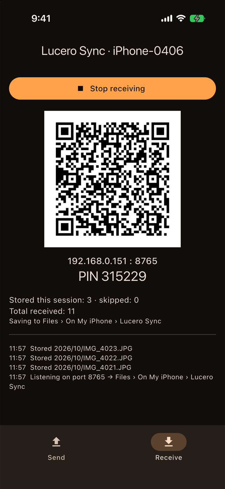
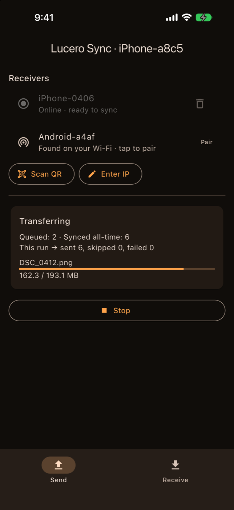
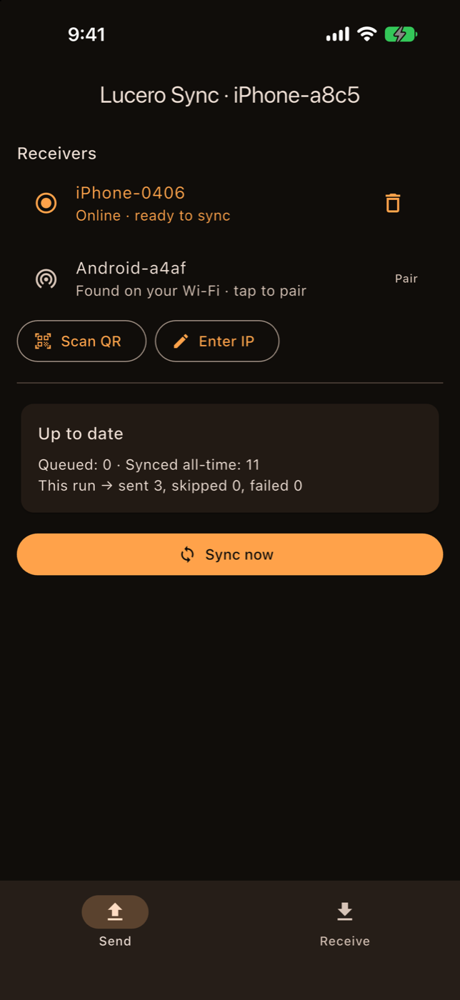

<div align="center">

# Lucero Sync

**Back up your iPhone photos to your Android phone over Wi-Fi. No cloud and no account.**

[](https://github.com/lucerowb/lucero-sync/actions/workflows/ci.yml)
[](LICENSE)


[Website](https://lucerosync.lucerowb.com/) · [User guide](https://lucerosync.lucerowb.com/guide.html) · [Download](https://github.com/lucerowb/lucero-sync/releases/latest) · [Architecture](ARCHITECTURE.md)

</div>

---

Lucero Sync copies the photo library on one phone to another phone on the same Wi-Fi network. The two phones talk directly to each other, so your photos never go to a server, and the app needs no account, subscription or internet connection.

<p align="center">
  
  
  
</p>

## Features

- **Direct phone-to-phone transfer** over your home Wi-Fi. Nothing leaves your network.
- **Originals, not copies.** HEIC, RAW/ProRAW and full-quality video are sent unedited, with EXIF intact.
- **Live Photos** arrive as a matched pair (`IMG_0001.HEIC` + `IMG_0001.MOV`).
- **Never duplicates.** The sender keeps a ledger of what's been synced, and the receiver checks every file by SHA-256 hash and metadata before accepting it.
- **Resumes where it stopped**, down to the byte, after Wi-Fi drops, app restarts or a receiver that changed IP.
- **Pairing in one scan.** The receiver shows a QR code; Bonjour/mDNS discovery and manual IP entry also work.
- **Either phone can send or receive.** iPhone → Android is the main use case, but every direction works.
- **No analytics, ads or accounts of our own.** On Android, the QR scanner's Google ML Kit library sends Google diagnostic data; the iPhone app sends nothing. See the [privacy policy](https://lucerosync.lucerowb.com/privacy.html).

## Install

| Platform | How |
|---|---|
| **Android** (receiver) | Download `lucero-sync.apk` from the [latest release](https://github.com/lucerowb/lucero-sync/releases/latest) and open it on your phone. |
| **iPhone** (sender) | Add the source `https://github.com/lucerowb/lucero-sync/releases/latest/download/altstore-source.json` in [AltStore](https://altstore.io) or [SideStore](https://sidestore.io), or build from source with a free Apple ID (below). |

The [user guide](https://lucerosync.lucerowb.com/guide.html) walks through installing, pairing and running your first sync, with a troubleshooting section.

## Build from source

You need [Flutter](https://docs.flutter.dev/get-started/install) 3.38 or later. For iOS you also need Xcode and CocoaPods; for Android you need Android Studio.

```bash
git clone https://github.com/lucerowb/lucero-sync.git
cd lucero-sync
flutter pub get
```

**Android:**

```bash
flutter build apk --release
```

Without a `key.properties` file, the release APK is signed with the debug key. To sign with your own keystore, see [Android signing](CONTRIBUTING.md#android-release-signing).

**iOS:** copy the signing template and fill in your Apple Team ID and a unique bundle ID:

```bash
cp ios/Flutter/Signing.example.xcconfig ios/Flutter/Signing.local.xcconfig
```

Then connect your iPhone and run:

```bash
flutter run --release
```

On a free Apple ID the app has to be reinstalled every 7 days.

## How it works

```
 iPhone (sender)                                   Android (receiver)
 ┌──────────────────┐   mDNS / QR pairing   ┌──────────────────────────┐
 │ Photo library    │ ───────────────────▶ │ HTTP server :8765        │
 │ diff vs. SQLite  │   POST /v1/check      │ dedup: sha256 / metadata │
 │ resumable queue  │ ───────────────────▶ │ .part files → verify     │
 │                  │   PUT /v1/files/…     │ → Pictures/LuceroSync/   │
 └──────────────────┘ ───────────────────▶ └──────────────────────────┘
```

[ARCHITECTURE.md](ARCHITECTURE.md) covers the database schema, deduplication rules, resume logic and wire protocol.

## Known limitations

- **Keep both apps open while syncing.** iOS doesn't allow long uploads in the background, and Android can suspend a backgrounded receiver.
- **Transfers use unencrypted HTTP on your LAN**, guarded by a 6-digit PIN. Use it on networks you trust.
- **Edits made after a photo is synced aren't re-sent.** The original is what gets backed up.

## Contributing

Bug reports, ideas and pull requests are welcome. Start with [CONTRIBUTING.md](CONTRIBUTING.md). Please report security issues privately as described in [SECURITY.md](SECURITY.md).

## License

[MIT](LICENSE). Lucero Sync is an independent project and isn't affiliated with Apple, Google or Resilio.
